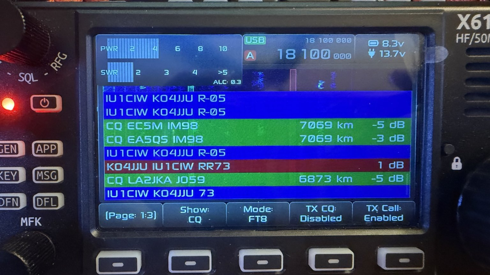
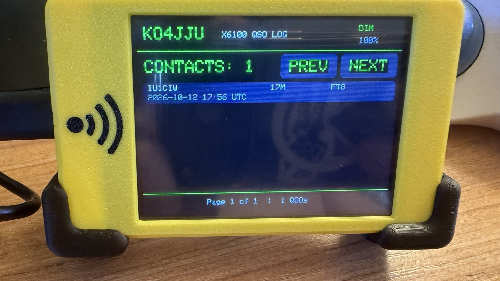
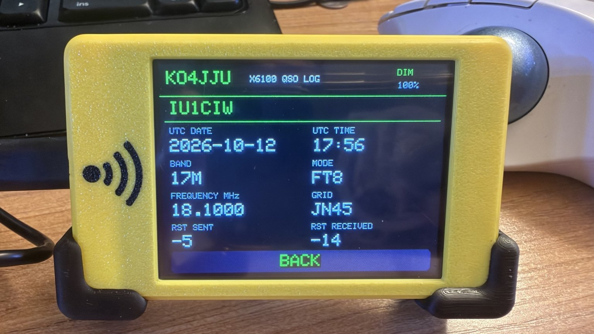
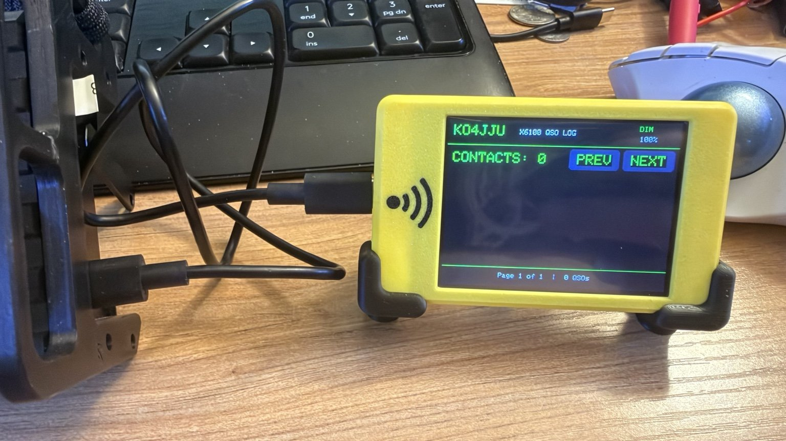

# X6100 CYD QSO Display

An external touchscreen QSO log display for the **Xiegu X6100** running **R1CBU Linux firmware**, using a **dual-USB ESP32 Cheap Yellow Display (CYD)**.

Developed and tested by **KO4JJU**.

## What it does

- Shows the newest 300 contacts from the X6100's `/mnt/ft_log.adi` log.
- Displays five QSOs per page with touchscreen PREV/NEXT navigation.
- Tap a QSO to see contact details.
- Automatically updates when the ADIF file changes (checks every 15 seconds).
- Automatically detects the CYD's CH340 USB serial port, even if Linux changes its device number.
- Retries when the CYD is disconnected and reconnects when it returns.
- Starts automatically on the tested R1CBU BusyBox system.
- Works **offline**: no Wi-Fi or internet required.

## Hardware tested

- Xiegu X6100 running R1CBU firmware.
- Dual-USB ESP32 CYD, ST7789 320 × 240 screen, XPT2046 touch controller.
- CH340 USB serial adapter on the CYD (`1a86:7523`).
- Working USB data cable between CYD and X6100 USB HOST.

**Board purchased for testing:** https://www.amazon.com/dp/B0F7X9LKF3

Other CYD revisions may have different screens or GPIO assignments and are **not tested**.

## How it works

The X6100 reads its ADIF file and sends selected contact fields to the CYD over USB serial at **115200 baud**. A Python background process watches for log changes and USB reconnections. The CYD stores the transferred display records in memory and provides the touchscreen interface.

**Important:** The CYD receives selected QSO fields, **not the complete original ADIF file**. Wireless ADIF download is a future idea, not part of this release.

## Beta X6100 Installer

A beginner-friendly installer is available in the
[installer folder](installer/).

The installer checks the radio's requirements, backs up
existing scripts, and installs the automatic QSO monitor.

**Status: Beta.** Compatibility checks have passed on the
tested X6100, but installation and automatic rollback
have not yet been fully tested.

For complete instructions, see the
[installation guide](docs/installation.md).

## Getting started

Follow the [step-by-step installation guide](docs/installation.md).

Change the callsign shown on the CYD by editing `cyd/src/station_config.h`:

```cpp
#define STATION_CALLSIGN "YOURCALL"
```

Then rebuild and reflash the CYD.

## Project folders

- `cyd/` — PlatformIO ESP32 firmware and ST7789 display configuration.
- `x6100/` — ADIF sender, USB watcher, launcher, and BusyBox startup script.
- `docs/` — Installation instructions.

## Known limits

- Displays at most the newest **300** contacts.
- Tested with one dual-USB CYD hardware revision.
- DIM button currently changes the displayed setting but does **not** change physical backlight brightness.
- Wi-Fi and Bluetooth features are **not implemented**.
- Automatic startup depends on the tested R1CBU firmware's `/etc/init.d/` boot behavior.
- If more than one CH340 USB serial adapter is attached, automatic port selection may need adjustment.

## Credits

This is an independent amateur-radio project. It is not an official Xiegu or R1CBU release.

Built using [R1CBU X6100 firmware](https://github.com/gdyuldin/x6100_gui), [TFT_eSPI](https://github.com/Bodmer/TFT_eSPI), and [XPT2046_Touchscreen](https://github.com/PaulStoffregen/XPT2046_Touchscreen). The dual-USB display configuration is based on the [CYD2USB setup](https://github.com/witnessmenow/ESP32-Cheap-Yellow-Display).

Check the upstream projects' licenses when redistributing their configuration or source files.


## Photos of the working setup

**X6100 completing an FT8 contact on 17 meters**



**CYD QSO list and details**





**USB connection to the X6100**



## License

See [LICENSE](LICENSE) for the project's MIT license. Third-party libraries retain their own licenses.
